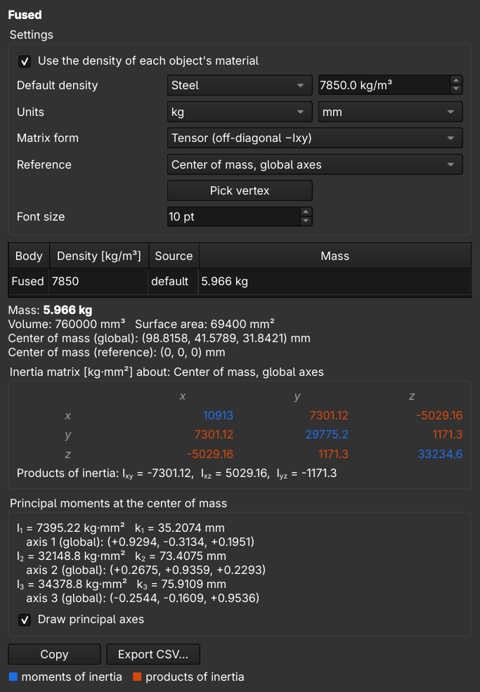

# Mass Properties for FreeCAD

A dock panel that shows the mass properties of the selected solids and updates
as you click through the model or edit it.



## Features

- Mass, volume, surface area and center of mass.
- Inertia matrix about a reference frame of your choice:
  - center of mass with global, body or principal axes,
  - body origin with body axes,
  - global origin,
  - any Local Coordinate System in the document,
  - a picked vertex (global axes).
- Principal moments of inertia, principal axes and radii of gyration;
  optionally drawn in the 3D view.
- Density from each object's FreeCAD material, with a default density
  (presets or custom) for objects without one.
- Several selected bodies are combined into one result, with a per-body table.
- Matrix in tensor form (off-diagonal −Ixy) or as products of inertia (+Ixy).
- Units kg or g, mm or m. Adjustable font size for screen sharing and projectors.
- Copy the results to the clipboard or export them to CSV.

Moments are colored blue and products of inertia orange, so it is easy to see
when a reference frame is aligned with the principal axes.

## Installation

In FreeCAD, open **Edit → Preferences → Addon Manager**, add a custom
repository with URL `https://github.com/klemengit/freecad-mass-properties` and
branch `main`, then install **Mass Properties** from the Addon Manager and
restart FreeCAD.

Manual install: clone the repository into FreeCAD's user `Mod` folder, for
example `~/.local/share/FreeCAD/v1-1/Mod` for FreeCAD 1.1 on Linux.

Requires FreeCAD 1.0 or newer.

## Usage

Click the **Mass Properties** button in the View toolbar (also in
**Tools → Mass Properties**). Select one or more solids in the 3D view or the
tree. Selecting a face or edge selects its body. Clearing the selection keeps
the last result.

To use a vertex as the reference point, click **Pick vertex** and then select a
vertex.

## Conventions

- The product of inertia is `Ixy = ∫ x y dm`. In tensor form the matrix holds
  `−Ixy` off the diagonal, so that `L = J ω`.
- Body axes are the object's own placement (including parent containers).
- Bodies selected together are summed as separate parts. Overlapping volume is
  counted twice; fuse the bodies first if they overlap.
- The built-in "Default" material counts as no material, so the default density
  is used.

## Tests

```bash
freecadcmd tests/test_compute.py
```

The tests compare the results with closed-form solutions for boxes, rotated and
moved bodies, PartDesign bodies, compounds and combined bodies.

## License

MIT
